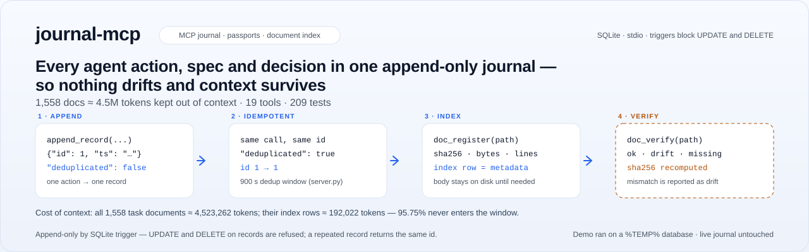
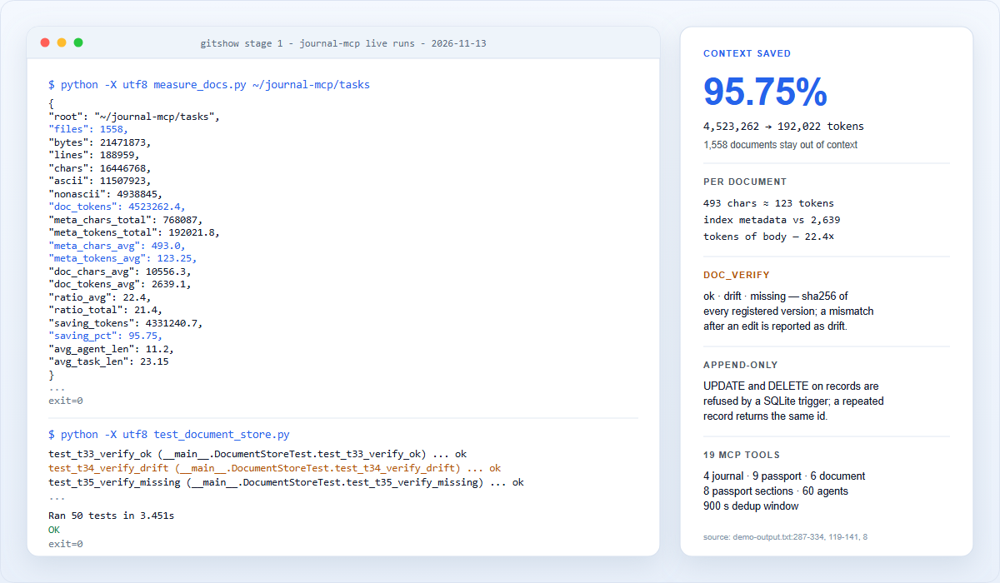

**English** · [Russian](README.ru.md)

<picture>
  <source media="(prefers-color-scheme: dark)" srcset="assets/gitshow/banner-dark.svg">
  
</picture>

# journal-mcp

**Every agent action, spec and decision in one append-only journal — so nothing drifts and context survives**

[](LICENSE)
[](requirements.txt)
[](#numbers)

One MCP server over SQLite: a journal, gated task passports and a document index. 19 tools, one dependency (`mcp<2`).



## Why this exists

An agent starts every session with an empty context. To pick up the work it reads the same spec, the same passport and the same three reports it read yesterday. In one real workspace that habit adds up: 1,558 Markdown files across task folders, 21.5 MB, 188,959 lines, about 4,523,262 tokens. No context window holds that, so the agent reads a slice and guesses the rest.

The reading is not the only cost. Nobody can say afterwards which decision came from the owner and which the agent inferred, because both leaked into the same prose.

journal-mcp keeps the three things a task needs next to the work, in SQLite:

- one journal row per action, with the task, the agent, the kind, the status and the source;
- one passport per task, whose versions are immutable and whose gates carry the owner's decision as a verbatim quote;
- one index row per document: path, task, kind, owner, status, sha256, bytes, lines.

An index row costs about 123 tokens. Held as metadata, all 1,558 documents cost 192,022 tokens instead of 4,523,262, so 95.75% of the corpus never enters the window. On the live index the 13 registered documents inside task folders cost 1,374 tokens of metadata against 56,364 tokens of bodies, a 97.56% saving, measured on 13 November 2026.

`doc_verify` closes the loop. It recomputes the hash of a file and answers `ok`, `drift`, `missing` or `unknown` from metadata alone, so an agent learns that a spec changed without pulling the spec back into context.

Two more rules keep the history usable. `append_record` is idempotent for 900 seconds, so a retried batch returns the first id instead of a second row. A gate refuses to close without a non-empty quote from the owner, so the decision in the passport is the owner's words, not a summary of them.

The bodies stay on disk. This is an index and a ledger, not a knowledge base.

## What you get

- **A journal nobody can rewrite.** SQLite triggers refuse `UPDATE` and `DELETE` on `records` (`server.py:162-167`). The only write is a new row.
- **Retries that do not duplicate.** The same call inside the 900 second window returns the first id with `deduplicated: true` (`server.py:139`, `server.py:185-200`). Records with `gate=1` or `gate=2` are never collapsed.
- **A spec that cannot drift silently.** Every passport version carries a SHA256 of its eight sections; gate 1 and gate 2 need the owner's decision quoted word for word (`passport_store.py:775-800`).
- **Document drift reported, body left alone.** `doc_verify` recomputes the file hash and compares it with the registered version (`document_store.py:664-709`).
- **Three contours in one process.** 4 journal tools, 9 passport tools and 6 document tools share one SQLite folder (`server.py:489-537`, `passport_store.py:477-940`, `document_store.py:449-664`).

## Quick start

```bash
git clone <repo> ~/journal-mcp
cd ~/journal-mcp
pip install -r requirements.txt
python server.py
```

The server speaks MCP over stdio and exits when the client disconnects. `mcp<2` is the only dependency (`requirements.txt:1`).

## Connect an MCP client

```json
{
  "mcpServers": {
    "journal": {
      "command": "python",
      "args": ["~/journal-mcp/server.py"],
      "env": {
        "JOURNAL_DB": "~/journal-mcp/journal.db",
        "PASSPORT_DB": "~/journal-mcp/passport.db",
        "DOCUMENTS_DB": "~/journal-mcp/documents.db"
      }
    }
  }
}
```

Each database has its own environment variable and its own default file name in the working folder: `JOURNAL_DB`, `PASSPORT_DB`, `DOCUMENTS_DB`. `JOURNAL_ROLES` points at the role whitelist, `PASSPORT_TASKS_ROOT` at the folder used for markdown export. All connections use `journal_mode=WAL` with `busy_timeout=5000` and two retries on `SQLITE_BUSY`.

## The journal

Four tools (`server.py:489-537`):

| tool | takes | returns |
|---|---|---|
| `append_record` | `task, agent, kind, status, summary`, optional `ref, next, gate` | `{id, ts, deduplicated}`, always |
| `query_records` | `task`, optional `after_id, kind, limit` | `{records, has_more, next_after_id}` |
| `get_state` | `task` | the last state row or `null` |
| `set_state` | `task, agent, summary`, optional `ref` | `{task, updated_ts}` |

Six kinds: `verdict`, `finding`, `fix`, `done`, `state`, `decision`. Three statuses: `ok`, `fail`, `not_checked`. Field limits: `summary` 350 characters, `next` 160, `ref` 600 (`server.py:130-132`). Errors name the field, the actual length and the limit.

The whitelist `kind` to `agent` is checked by the server. Verdicts come from reviewers, `fix` and `done` from makers, `decision` from mode leads. The full list of 60 agents lives in [docs/roles.md](docs/roles.md).

A gate is an event, not a state update: two identical `gate=1` writes produce two rows. A duplicate write and its insert run in one `BEGIN IMMEDIATE` transaction, so two processes writing the same record end with one row.

## Passports

Nine tools build a task passport: eight fixed sections, immutable versions, two gates (`passport_store.py:52-61`, `passport_store.py:477-940`).

- `passport_create`, `passport_set_section`, `passport_set_sections` write; `passport_get`, `passport_status`, `passport_diff`, `passport_list`, `passport_export` read; `passport_gate` records a gate.
- A version is frozen when written. Any edit creates a new version with a new SHA256, and the gate status does not carry over.
- Status is `draft`, `gate1`, `gate2` or `rejected`. A rejected version is closed: a further gate on it is refused (`passport_store.py:100`).
- Gate 1 requires all eight sections non-empty and a body of at most 120 lines. Gate 2 requires an approved gate 1 on the same version.
- A passport belongs to a mode. Writing is limited to that mode's writer, gating to that mode's lead, and there are nine modes and 17 roles in total (`passport_store.py:72-90`). Passports created before the `mode` column existed are read as `mode-factory`.

`passport_export` produces a markdown snapshot. The file writer accepts one path only, `tasks/<task>/passport.md` under `PASSPORT_TASKS_ROOT`; `..` is refused.

## The document index

Six tools carry document metadata while the bodies stay as files (`document_store.py:449-664`): `doc_register`, `doc_list`, `doc_status`, `doc_link`, `doc_set_status`, `doc_verify`.

- `doc_register` stores path, task, kind, owner, status and a SHA256 of the raw bytes. Registering unchanged content is a no-op with `deduplicated: true`.
- Status is `draft`, `review`, `approved` or `superseded`. Allowed moves are `draft → review`, `review → approved` (only by an agent from the `verdict` list), `review → draft`, and `superseded` from any of `draft`, `review` or `approved` (`document_store.py:57-67`).
- A new version of an `approved` or `superseded` document returns it to `draft`, because the approved revision is now stale (`document_store.py:440-446`).
- `versions` and `links` are append-only: four triggers refuse `UPDATE` and `DELETE` (`document_store.py:112-121`).
- `doc_link` checks the journal id against the journal database and fails closed when that database is unreachable.

`doc_verify` with a path returns `{path, status, expected_sha8, actual_sha8}`. Without a path it returns a summary over the documents in `draft`, `review` and `approved`, leaving `superseded` out: `{checked, count, ok, drift, missing, unknown}`.

Roles come from the same whitelist. `owner` and `agent` are declared by the caller; the server checks membership, not identity. A missing role file blocks role-bound calls and leaves `doc_list`, `doc_status` and `doc_verify` working.

## Numbers

| what | value | where |
|---|---|---|
| MCP tools | 19 (4 journal, 9 passport, 6 document) | `server.py:489-537`, `passport_store.py:477-940`, `document_store.py:449-664` |
| record kinds | 6 | `server.py:50-51` |
| agents in the whitelist | 60 | `journal_roles.json:3-153` |
| passport modes / passport roles / sections | 9 / 17 / 8 | `passport_store.py:52-90` |
| field limits | summary 350, next 160, ref 600 | `server.py:130-132` |
| dedup window | 900 s | `server.py:139` |
| task corpus measured | 1,558 files, 21.5 MB, 188,959 lines, 4,523,262 tokens | measured 13 Nov 2026 |
| index row | 493 characters, about 123 tokens | measured 13 Nov 2026 |
| corpus as metadata | 192,022 tokens, 95.75% less than the bodies | measured 13 Nov 2026 |
| checks | 209 (64 passport, 50 document, 84 journal, 5 transport, 6 validation) | measured 13 Nov 2026 |

The token figure is an estimate, `ASCII characters / 4 + other characters / 3`. It is deliberately rough: a real tokenizer will land within tens of percent, while the ratio between a body and its metadata row stays stable.

## Roles

The whitelist, the passport writer and lead for each of the nine modes, and the agent to kind matrix for all 60 agents: [docs/roles.md](docs/roles.md).

## Tests

```bash
python -m py_compile server.py passport_store.py document_store.py
python -X utf8 test_passport_store.py     # 64 checks
python -X utf8 test_document_store.py     # 50 checks
python -X utf8 test_journal.py            # 84 checks
python -X utf8 test_mcp_transport.py      # 5 checks, real stdio round trip
python -m unittest -v test_server_validation  # 6 checks
```

209 checks, all passing on Python 3.12 on 13 November 2026. Every test uses a temporary database and leaves the live journal untouched.

## When not to use it

- One short session with nothing to recall. There is no history to keep.
- Several teams writing one file at the same time. SQLite serialises writes, with two retries and a five second busy timeout, and that is the limit.
- Untrusted callers. Roles are declarations, not authentication; put the server behind your own access control.
- Exact token accounting. The numbers above come from a character estimate, not from a tokenizer.

## License

MIT, see [LICENSE](LICENSE). Copyright (c) 2026 Klaus101-ai.

---

[Russian version](README.ru.md)
