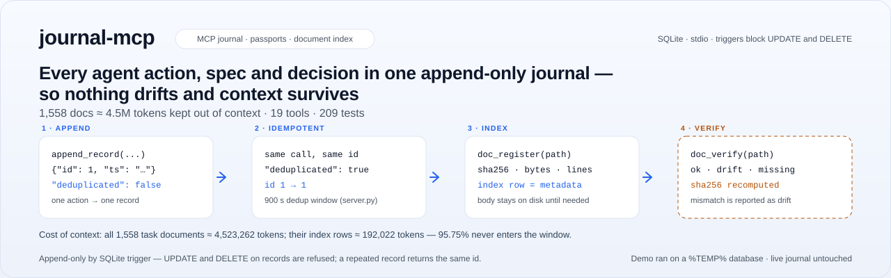
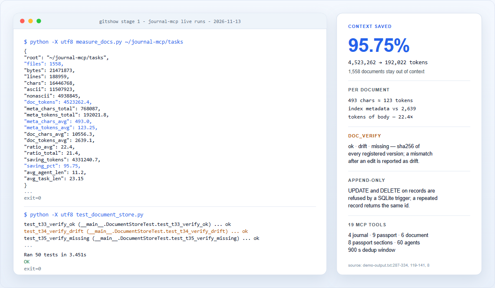

[English](README.md) · **Русский**

<picture>
  <source media="(prefers-color-scheme: dark)" srcset="assets/gitshow/banner-dark.svg">
  
</picture>

# journal-mcp

**Каждое действие агента, каждая спека и каждое решение в одном журнале только на добавление — ничего не расползается, контекст переживает сессию**

[](LICENSE)
[](requirements.txt)
[](#числа)

Один MCP-сервер поверх SQLite: журнал, паспорта задач с гейтами и индекс документов. 19 инструментов, одна зависимость (`mcp<2`).



## Зачем это нужно

Агент начинает каждую сессию с пустым контекстом. Чтобы продолжить работу, он перечитывает ту же спеку, тот же паспорт и те же три отчёта, что читал вчера. В одном рабочем пространстве эта привычка стоит дорого: 1 558 markdown-файлов по папкам задач, 21,5 МБ, 188 959 строк, около 4 523 262 токенов. Ни одно контекстное окно столько не держит, поэтому агент читает кусок и догадывается об остальном.

Дело не только в чтении. Потом никто не скажет, какое решение принял владелец, а какое агент вывел сам: и то и другое осело в одной прозе.

journal-mcp держит рядом с работой три вещи, которые задаче нужны дальше, и складывает их в SQLite:

- строка журнала на каждое действие: задача, агент, вид записи, статус, источник;
- паспорт на задачу, где версии неизменяемы, а гейты несут решение владельца дословной цитатой;
- строка индекса на каждый документ: путь, задача, вид, владелец, статус, sha256, байты, строки.

Строка индекса стоит около 123 токенов. Все 1 558 документов в виде метаданных стоят 192 022 токена вместо 4 523 262, то есть 95,75% корпуса вообще не попадает в окно. На живом индексе 13 зарегистрированных документов внутри папок задач дают 1 374 токена метаданных против 56 364 токенов тел, экономия 97,56%. Замер 13 ноября 2026.

`doc_verify` закрывает круг. Он пересчитывает хеш файла и отвечает `ok`, `drift`, `missing` или `unknown` по одним метаданным, поэтому агент узнаёт, что спека изменилась, не втягивая спеку обратно в контекст.

Ещё два правила держат историю пригодной. `append_record` идемпотентен 900 секунд: повторная пачка возвращает первый id, а не вторую строку. Гейт не закрывается без непустой цитаты владельца, поэтому в паспорте лежат слова владельца, а не их пересказ.

Тела документов остаются на диске. Это индекс и реестр, а не база знаний.

## Что вы получаете

- **Журнал, который нельзя переписать.** Триггеры SQLite отклоняют `UPDATE` и `DELETE` по таблице `records` (`server.py:162-167`). Единственная запись — новая строка.
- **Повторы без дублей.** Тот же вызов внутри окна 900 секунд возвращает первый id с `deduplicated: true` (`server.py:139`, `server.py:185-200`). Записи с `gate=1` и `gate=2` не схлопываются никогда.
- **Спека, которая не расползается молча.** У каждой версии паспорта есть SHA256 восьми разделов; гейт 1 и гейт 2 требуют решения владельца, процитированного дословно (`passport_store.py:775-800`).
- **Расхождение документов видно, тело не трогаем.** `doc_verify` пересчитывает хеш файла и сравнивает с зарегистрированной версией (`document_store.py:664-709`).
- **Три контура в одном процессе.** 4 инструмента журнала, 9 инструментов паспорта и 6 инструментов документов делят одну папку SQLite (`server.py:489-537`, `passport_store.py:477-940`, `document_store.py:449-664`).

## Быстрый старт

```bash
git clone <repo> ~/journal-mcp
cd ~/journal-mcp
pip install -r requirements.txt
python server.py
```

Сервер говорит по MCP через stdio и завершается вместе с клиентом. Единственная зависимость — `mcp<2` (`requirements.txt:1`).

## Подключение MCP-клиента

```json
{
  "mcpServers": {
    "journal": {
      "command": "python",
      "args": ["~/journal-mcp/server.py"],
      "env": {
        "JOURNAL_DB": "~/journal-mcp/journal.db",
        "PASSPORT_DB": "~/journal-mcp/passport.db",
        "DOCUMENTS_DB": "~/journal-mcp/documents.db"
      }
    }
  }
}
```

У каждой базы своя переменная окружения и свой файл по умолчанию в рабочей папке: `JOURNAL_DB`, `PASSPORT_DB`, `DOCUMENTS_DB`. `JOURNAL_ROLES` указывает на список ролей, `PASSPORT_TASKS_ROOT` — на папку для экспорта markdown. Все соединения работают с `journal_mode=WAL`, `busy_timeout=5000` и двумя повторами на `SQLITE_BUSY`.

## Журнал

Четыре инструмента (`server.py:489-537`):

| инструмент | принимает | возвращает |
|---|---|---|
| `append_record` | `task, agent, kind, status, summary`, необязательные `ref, next, gate` | `{id, ts, deduplicated}` всегда |
| `query_records` | `task`, необязательные `after_id, kind, limit` | `{records, has_more, next_after_id}` |
| `get_state` | `task` | последнюю строку состояния или `null` |
| `set_state` | `task, agent, summary`, необязательный `ref` | `{task, updated_ts}` |

Шесть видов: `verdict`, `finding`, `fix`, `done`, `state`, `decision`. Три статуса: `ok`, `fail`, `not_checked`. Лимиты полей: `summary` 350 символов, `next` 160, `ref` 600 (`server.py:130-132`). Ошибка называет поле, фактическую длину и лимит.

Сервер сам проверяет таблицу «вид записи → агент». Вердикты пишут проверяющие, `fix` и `done` — делающие, `decision` — лиды режимов. Полный список 60 агентов — в [docs/roles.md](docs/roles.md).

Гейт — это событие, а не обновление состояния: две одинаковые записи `gate=1` дают две строки. Проверка дубля и вставка идут одной транзакцией `BEGIN IMMEDIATE`, поэтому два процесса с одинаковой записью оставляют одну строку.

## Паспорта

Девять инструментов собирают паспорт задачи: восемь фиксированных разделов, неизменяемые версии, два гейта (`passport_store.py:52-61`, `passport_store.py:477-940`).

- Пишут `passport_create`, `passport_set_section`, `passport_set_sections`; читают `passport_get`, `passport_status`, `passport_diff`, `passport_list`, `passport_export`; гейт фиксирует `passport_gate`.
- Версия застывает при записи. Любая правка создаёт новую версию с новым SHA256, статус гейта не переносится.
- Статус: `draft`, `gate1`, `gate2` или `rejected`. Отклонённая версия закрыта: следующий гейт по ней отказывает (`passport_store.py:100`).
- Гейт 1 требует восемь непустых разделов и тело не длиннее 120 строк. Гейт 2 требует одобренный гейт 1 на той же версии.
- Паспорт принадлежит режиму. Пишет только писатель этого режима, гейтит только его лид; всего девять режимов и 17 ролей (`passport_store.py:72-90`). Паспорта, созданные до появления колонки `mode`, читаются как `mode-factory`.

`passport_export` собирает markdown-снимок. Файл пишется только по одному пути, `tasks/<task>/passport.md` относительно `PASSPORT_TASKS_ROOT`; `..` запрещён.

## Индекс документов

Шесть инструментов ведут метаданные, тела остаются файлами (`document_store.py:449-664`): `doc_register`, `doc_list`, `doc_status`, `doc_link`, `doc_set_status`, `doc_verify`.

- `doc_register` хранит путь, задачу, вид, владельца, статус и SHA256 сырых байтов. Повторная регистрация того же содержимого ничего не меняет и отвечает `deduplicated: true`.
- Статус: `draft`, `review`, `approved` или `superseded`. Разрешены переходы `draft → review`, `review → approved` (только агентом из списка `verdict`), `review → draft`, а в `superseded` можно уйти из `draft`, `review` и `approved` (`document_store.py:57-67`).
- Новая версия документа в статусе `approved` или `superseded` возвращает его в `draft`: утверждённая редакция устарела (`document_store.py:440-446`).
- `versions` и `links` только на добавление: четыре триггера отклоняют `UPDATE` и `DELETE` (`document_store.py:112-121`).
- `doc_link` сверяет id записи с базой журнала и отказывает, если та недоступна.

`doc_verify` с путём возвращает `{path, status, expected_sha8, actual_sha8}`. Без пути — сводку по документам в статусах `draft`, `review` и `approved` без `superseded`: `{checked, count, ok, drift, missing, unknown}`.

Роли берутся из того же списка. `owner` и `agent` заявляет вызывающий; сервер проверяет членство в роли, а не личность. Если файл ролей недоступен, операции с ролью отказывают, а `doc_list`, `doc_status` и `doc_verify` работают.

## Числа

| показатель | значение | источник |
|---|---|---|
| Инструментов MCP | 19 (4 журнала, 9 паспорта, 6 документов) | `server.py:489-537`, `passport_store.py:477-940`, `document_store.py:449-664` |
| Видов записей | 6 | `server.py:50-51` |
| Агентов в списке ролей | 60 | `journal_roles.json:3-153` |
| Режимов / ролей паспорта / разделов | 9 / 17 / 8 | `passport_store.py:52-90` |
| Лимиты полей | summary 350, next 160, ref 600 | `server.py:130-132` |
| Окно дедупликации | 900 с | `server.py:139` |
| Замеренный корпус задач | 1 558 файлов, 21,5 МБ, 188 959 строк, 4 523 262 токена | замер 13.11.2026 |
| Строка индекса | 493 символа, около 123 токенов | замер 13.11.2026 |
| Корпус в виде метаданных | 192 022 токена, на 95,75% меньше тел | замер 13.11.2026 |
| Проверок | 209 (64 паспорт, 50 документы, 84 журнал, 5 транспорт, 6 валидация) | замер 13.11.2026 |

Оценка токенов — `ASCII-символы / 4 + прочие символы / 3`. Она намеренно грубая: реальный токенизатор даст другой результат в пределах десятков процентов, а соотношение между телом и его строкой метаданных устойчиво.

## Роли

Список ролей, писатель и лид паспорта для каждого из девяти режимов, матрица «агент → вид записи» для всех 60 агентов: [docs/roles.md](docs/roles.md).

## Тесты

```bash
python -m py_compile server.py passport_store.py document_store.py
python -X utf8 test_passport_store.py     # 64 проверки
python -X utf8 test_document_store.py     # 50 проверок
python -X utf8 test_journal.py            # 84 проверки
python -X utf8 test_mcp_transport.py      # 5 проверок, живой круг stdio
python -m unittest -v test_server_validation  # 6 проверок
```

209 проверок, все проходят на Python 3.12, 13 ноября 2026. Каждый тест работает с временной базой и не трогает живой журнал.

## Когда не подходит

- Одна короткая сессия, вспоминать нечего. Историю не из чего собирать.
- Несколько команд пишут один файл одновременно. SQLite выстраивает записи в очередь, с двумя повторами и таймаутом пять секунд, и это предел.
- Недоверенные вызывающие. Роли — это заявление, а не аутентификация; ставьте сервер за свой контроль доступа.
- Точный учёт токенов. Числа выше получены оценкой по символам, а не токенизатором.

## Лицензия

MIT, см. [LICENSE](LICENSE). Copyright (c) 2026 Klaus101-ai.

---

[English version](README.md)
